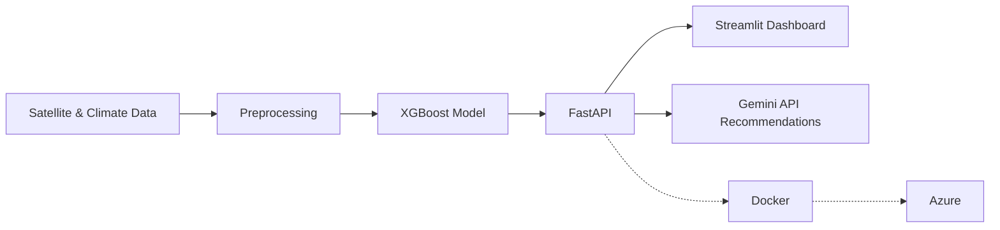

  

  
  
  

---

## About Me

Computer Science student (class of 2027) and Machine Learning Engineer. I build **end-to-end AI systems**: data preprocessing, model training, APIs, dashboards, containerization, and cloud deployment.

- Currently building skills in **Generative AI** (LLMs, RAG) through the Route Academy Generative AI Diploma
- I focus on turning notebooks into **production-ready, containerized applications**
- ICPC participant, so I enjoy algorithms and problem-solving under pressure
- I write educational ML content in Arabic for beginners on LinkedIn

---

## Tech Stack

| | |
|---|---|
| **Languages** |  |
| **ML / DL** |   |
| **GenAI** |    |
| **Backend & Apps** |   |
| **Deployment & MLOps** |  |

---

## Featured Projects

### [AgriGuard AI](https://github.com/MennaAbukhadra/REPO-NAME)
End-to-end system that predicts crop stress from satellite and climate data, then generates AI-powered recommendations.

- **FastAPI** backend and interactive **Streamlit** dashboard for field monitoring
- **XGBoost** for stress prediction, **Gemini API** for recommendations
- Containerized with **Docker** and deployed on **Microsoft Azure**

---

### [Credit Card Fraud Detection](https://github.com/MennaAbukhadra/REPO-NAME)
Classification system that flags fraudulent transactions on highly imbalanced data.

- Handled **class imbalance**, with feature engineering and model evaluation
- Visual analysis of transaction behavior and fraud patterns
- Streamlit app for interactive demos

---

### [Heart Disease Prediction](https://github.com/MennaAbukhadra/REPO-NAME)
End-to-end ML pipeline with real-time predictions and explainability.

- **SHAP** explainability to understand what drives each prediction
- Interactive Streamlit app for real-time inference

---

## Training & Content

- **Route Academy**: Generative AI Diploma (Aug 2026 – Present)
- **Digital Egypt Pioneers Initiative (DEPI)**: AI & Machine Learning Trainee, Microsoft ML Engineer track (Dec 2025 – Jul 2026)
- **Route Academy**: AI & Machine Learning Trainee (Jul 2025 – Dec 2025)
- **Content**: Arabic ML series for beginners on [LinkedIn](https://www.linkedin.com/in/YOUR-LINKEDIN)

---

## GitHub Activity

  
  

